# ha-stock-card

[](https://www.home-assistant.io/integrations/marketplace/)
[](https://github.com/juju35/ha-stock-card/actions/workflows/hacs.yml)
[](https://github.com/juju35/ha-stock-card/actions/workflows/validate.yml)
[](https://github.com/juju35/ha-stock-card/actions/workflows/lint.yml)
[](https://github.com/juju35/ha-stock-card/releases/latest)
[](https://github.com/juju35/ha-stock-card/blob/main/LICENSE)
[](https://buymeacoffee.com/julienstep9)

<p align="center"></p>

<p align="center">
  
</p>

Lovelace cards for Home Assistant to follow stock and market quotes: price, change of the day, sparkline and the total of your portfolio at a glance.

Supported integrations:

- [Yahoo Finance](https://github.com/iprak/yahoofinance) — stocks, indices, funds and currencies, with the day's change and the market status;
- any other price sensor (a crypto-currency, a commodity, a fund from another integration…) — its change is taken from its history.

Yahoo Finance sensors are **discovered automatically**: with no configuration, the card lists them all.

[](https://my.home-assistant.io/redirect/marketplace_repository/?owner=juju35&repository=ha-stock-card&category=plugin)

| Stock Card | Stock Mini Card |
|---|---|
| 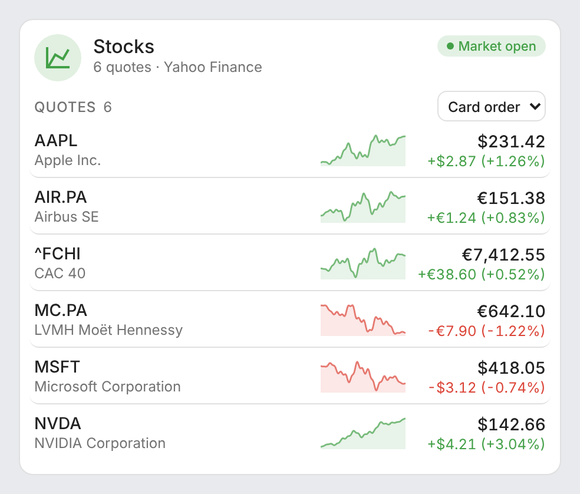 | 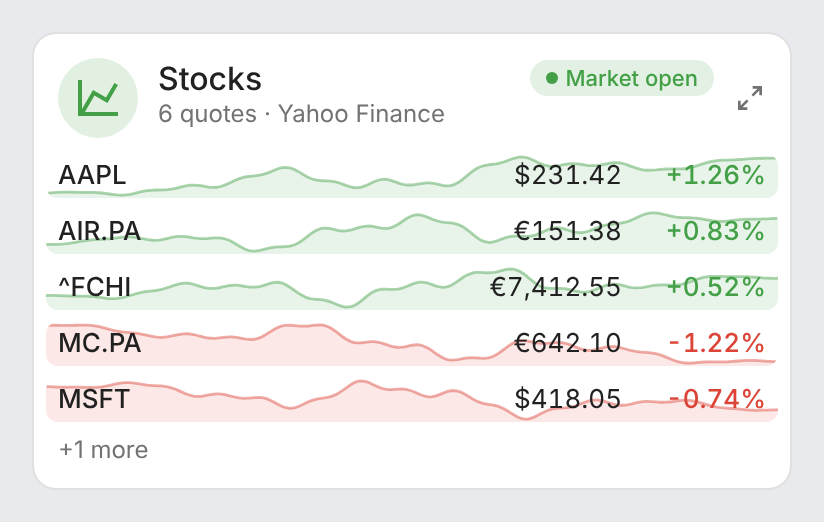 |

## Features

- Two cards: a full **Stock Card** and a compact **Stock Mini Card**
- Automatic discovery of the Yahoo Finance sensors, or your own list of quotes, mixing Yahoo Finance and any price sensor
- Price in its currency, formatted for your language, and the change of the day in value and percentage, green or red
- Sparkline of each quote over 24 hours, 5 days, 1 month, 3 months or 1 year, from the recorder's statistics (or the state history of a sensor without statistics), coloured by its own trend
- Optional portfolio: give a quantity (and a purchase price) per quote to get the value of each position, the portfolio total, its change of the day and your gain, one total per currency or all in the currency of your choice (`currency`)
- Market status chip (open, pre-market, after hours, closed) from Yahoo Finance
- Sort menu in the card: card order, name, change or position value (`sort_by` sets the default)
- A new price flashes in the colour of its move
- Click any quote to open its Home Assistant history (more-info dialog)
- Detail button at the top right of the mini card: it switches to the full card and back; a click anywhere outside the card brings the compact view back
- Visual editor in the dashboard UI for both cards, quantities, purchase prices, currency and exchange rate sensors included (no YAML needed)
- Light and dark mode; English, French, German, Spanish, Serbian (Cyrillic and Latin), Italian, Dutch, European Portuguese, Polish, Romanian, Danish, Swedish, Bulgarian, Russian, Ukrainian, Hungarian, Slovak, Czech, Slovenian, Latvian and Greek
- Single file, no external dependency

## Supported integrations

| Integration | What the cards show |
|---|---|
|  [Yahoo Finance](https://github.com/iprak/yahoofinance) (Marketplace) | Everything: symbol and company name, price in its currency, change of the day (`regularMarketChange`, `regularMarketChangePercent`), market status (`marketState`), sparkline |
| Any numeric sensor with a price | Name, price with its unit (an ISO currency code such as `EUR` is shown with its symbol), sparkline; the change is the change over the sparkline's period, from the sensor's history (`· 24 h` after it), unless the sensor has `change` / `change_percent` or `previous_close` attributes |

## Prerequisites

Home Assistant 2024.8 or later, and the [Yahoo Finance integration](https://github.com/iprak/yahoofinance) (available in the Marketplace) or any sensor holding a price. The sparklines need the recorder (on by default).

## Installation

### Via the Marketplace (recommended)

Click the button below to add the repository directly:

[](https://my.home-assistant.io/redirect/marketplace_repository/?owner=juju35&repository=ha-stock-card&category=plugin)

Then click **Install**, and reload your browser when the Marketplace asks you to.

Or manually:

1. Open **Settings → Marketplace → Add from link** (top right; this needs a GitHub account connected)
2. Add `https://github.com/juju35/ha-stock-card` — Type: **Dashboard**
3. Open **Stock Card** and click **Install**
4. Clear your browser cache and refresh

### Manual

1. Download `stock-card.js` and the `stock-card.i18n.*.js` translation files from the [latest release](https://github.com/juju35/ha-stock-card/releases/latest)
2. Copy them all to `/config/www/` (without the translation files, the cards show in English)
3. Go to **Settings → Dashboards → ⋮ → Resources** → Add resource:
   - URL: `/local/stock-card.js`
   - Type: **JavaScript Module**
4. Clear your browser cache and refresh

## Configuration

### Visual editor

Edit a dashboard, click **Add card** and search for **Stock Card** or **Stock Mini Card**. With no quote selected, the card lists every Yahoo Finance sensor; pick quotes in the list to choose them and their order. On the full card, the **Portfolio** section takes a quantity and a purchase price per quote. The preview updates live, and options left at their default are kept out of the generated YAML.

### Minimal

```yaml
type: custom:stock-card
```

```yaml
type: custom:stock-mini-card
```

### Full options

```yaml
type: custom:stock-card
title: Investments
url: https://finance.yahoo.com/portfolios
entities:
  - entity: sensor.yahoofinance_air_pa
    quantity: 40
    purchase_price: 128.5
  - entity: sensor.yahoofinance_mc_pa
    name: LVMH
    quantity: 6
    purchase_price: 702
  - sensor.yahoofinance_fchi
  - entity: sensor.bitcoin_price
    quantity: 0.12
history_period: 1m
sort_by: value
change_display: both
decimals: 2
show_title: true
show_subtitle: true
show_name: true
show_history: true
show_total: true
show_market_state: true
currency: EUR
exchange_rates:
  USD: sensor.yahoofinance_eurusd_x
language: fr
```

```yaml
type: custom:stock-mini-card
title: Stocks
max_items: 5
history_period: 1d
show_history: true
show_total: true
zoom: true
```

### Options reference

| Option | Card | Default | Description |
|---|---|---|---|
| `entities` | both | Every Yahoo Finance sensor | Quotes to show, in this order: entity ids, or objects with `entity` and optional `name`, `quantity` and `purchase_price` |
| `entities[].name` | both | Company name | Name shown under the symbol (Yahoo Finance: `shortName`, else `longName`, else the friendly name) |
| `entities[].quantity` | both | — | Shares (or units) held: shows the position value and adds it to the portfolio total |
| `entities[].purchase_price` | both | — | Price paid per share, in the quote's currency: adds the gain to the portfolio total |
| `title` | both | `Stocks` (translated) | Card title |
| `show_title` | both | `true` | Show the title in the header |
| `show_subtitle` | both | `true` | Show the subtitle (number of quotes, source) under the title |
| `url` | both | Yahoo Finance | Address opened in a new tab when clicking the header icon (http or https) |
| `history_period` | both | `1d` | Sparkline period: `1d` (24 hours), `5d`, `1m`, `3m` or `1y`. 24 hours uses the 5-minute statistics, 5 days and 1 month the hourly ones, 3 months and 1 year the daily ones |
| `show_history` | both | `true` | Sparklines (full card: next to each price; mini card: behind each row) |
| `sort_by` | both | `none` | Default order: `none` (card order), `name`, `change` (day change in %, highest first) or `value` (position value, highest first); the menu in the full card changes it until the page is reloaded |
| `change_display` | full | `both` | Change shown under each price: `both` (`+1.24 (+0.83%)`), `percent` or `absolute` |
| `decimals` | both | `2` (`4` under 1) | Decimals of the prices and amounts |
| `show_name` | full | `true` | Company name under the symbol |
| `show_total` | both | `true` | Portfolio total (shown when at least one quote has a `quantity`) |
| `currency` | both | — | Currency of the portfolio total, its day change and the gain (ISO code: `EUR`, `USD`, `GBP`…); without it, one total per currency. See [Currency of the total](#currency-of-the-total) |
| `exchange_rates` | both | Yahoo Finance pairs | Rates used by `currency`: per currency (`USD: 0.92`, 1 USD = 0.92 of `currency`) or per pair (`EURUSD: 1.085`, 1 EUR = 1.085 USD), a number or a sensor. Without it, a Yahoo Finance currency pair (`EURUSD=X` or `USDEUR=X`) is used when there is one |
| `show_market_state` | both | `true` | Market status chip (Yahoo Finance quotes only) |
| `max_items` | mini | `5` | Quotes shown in the compact view; the others are counted below (`+2 more`) and shown by the detail button |
| `zoom` | mini | `true` | Detail button at the top right: switches to the full card and back (`false` removes it) |
| `language` | both | Auto | Force language: `en`, `fr`, `de`, `es`, `sr`, `sr-Latn`, `it`, `nl`, `pt`, `pl`, `ro`, `da`, `sv`, `bg`, `ru`, `uk`, `hu`, `sk`, `cs`, `sl`, `lv` or `el` (auto-detects from HA settings) |

## Portfolio

Give a `quantity` to the quotes you hold (and, optionally, the `purchase_price` paid per share): each row then shows the number held and the position value, and a total sits above the list with the change of the day and, when purchase prices are set, the gain against them.

Totals are made per currency: a portfolio holding euros and dollars shows two totals, unless `currency` converts them into one (see below). The day change only adds the quotes that know it (Yahoo Finance); a sensor whose change comes from its history counts in the value and the gain, not in the day change.

| Light | Dark |
|---|---|
| 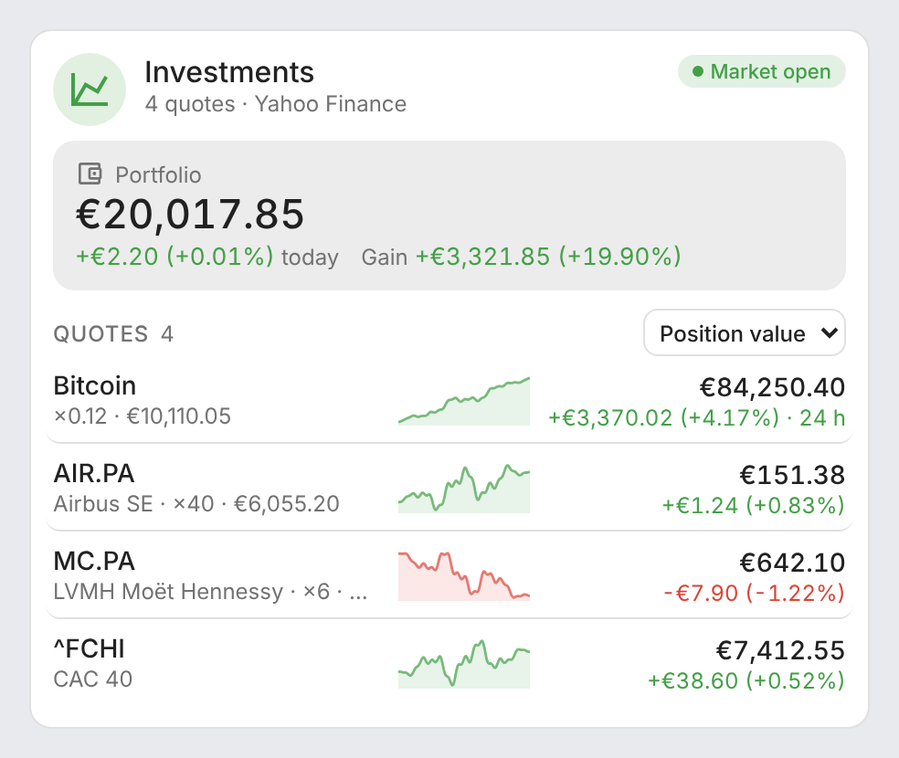 | 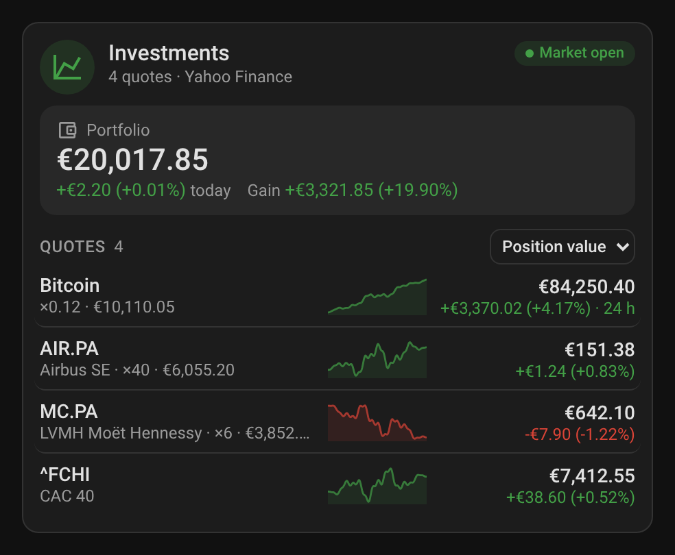 |
| 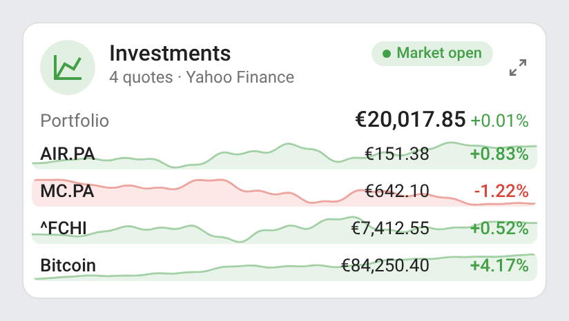 | 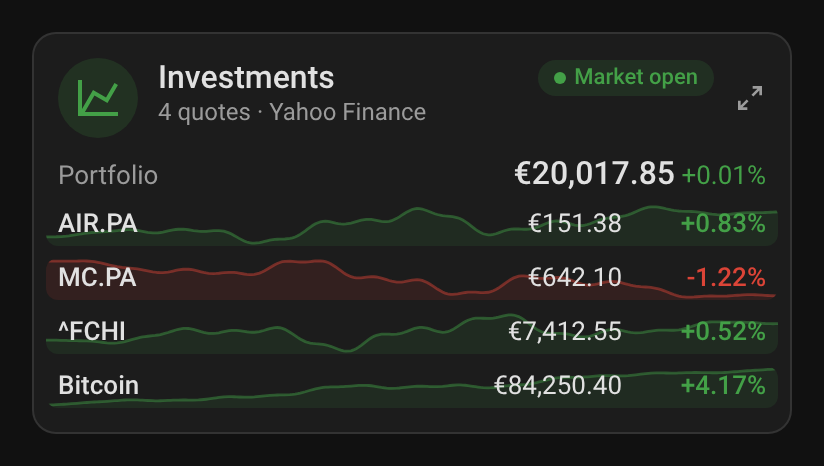 |

### Currency of the total

Set `currency` to show the portfolio total, its change of the day and the gain in one currency, for instance in euros for a portfolio of US stocks. The prices and the position values of the rows stay in each quote's own currency.

The rates are taken, in this order:

1. from `exchange_rates`, a number or a sensor per currency (`USD: 0.92`: 1 USD = 0.92 EUR) or per pair (`EURUSD: sensor.eur_usd`: 1 EUR = 1.0862 USD, the market's way of quoting it). A Yahoo Finance pair sensor (`EURUSD=X`) is read the right way round whatever key it is given under;
2. else from the Yahoo Finance currency pairs of Home Assistant: add the symbol `EURUSD=X` (or `USDEUR=X`) to the integration and nothing else is needed.

```yaml
type: custom:stock-card
title: US stocks
currency: EUR
entities:
  - entity: sensor.yahoofinance_aapl
    quantity: 12
    purchase_price: 168.4
  - entity: sensor.yahoofinance_msft
    quantity: 5
    purchase_price: 377
  - entity: sensor.yahoofinance_nvda
    quantity: 30
    purchase_price: 118.2
# Optional with a Yahoo Finance EURUSD=X sensor, found on its own:
exchange_rates:
  EURUSD: sensor.yahoofinance_eurusd_x
```

The rate used is shown next to **Portfolio** (`1 USD = €0.9206`, a click opens its sensor). A currency with no rate is not converted: it keeps its own total, marked `no rate to EUR`. Prices in pence (`GBp`, London) are converted through pounds, and cents (`ZAc`) and agorot (`ILA`) likewise.

Amounts are converted at the current rate: the day change and the gain are those of the stocks, without the move of the currency itself (purchase prices are in the quote's currency).

| Light | Dark |
|---|---|
| 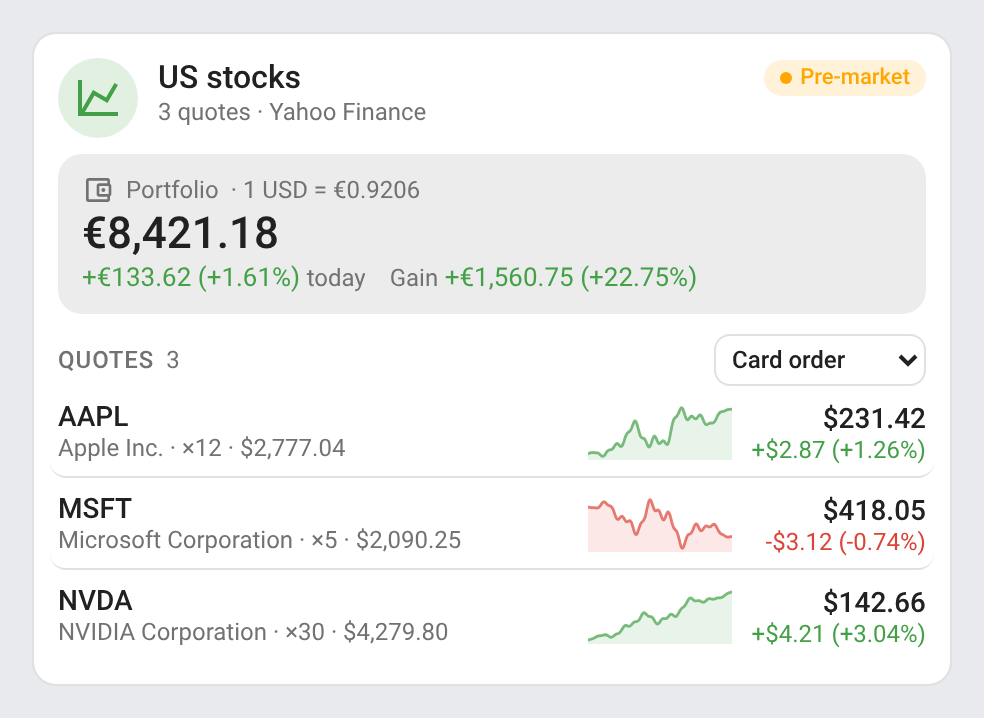 | 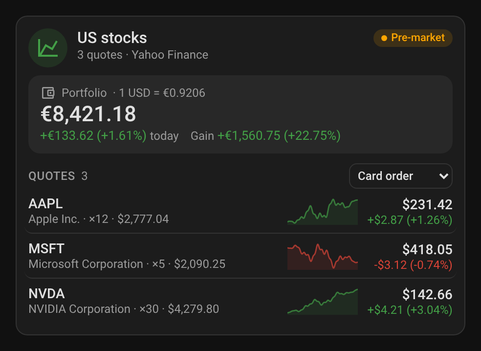 |

## Other price sensors

Any sensor holding a price can be listed next to the Yahoo Finance quotes: a crypto-currency, a commodity, a fund from another integration, a template sensor. Its unit is shown after the price (an ISO currency code such as `EUR` or `USD` is shown with its symbol). With no change attributes, the change shown is the change over the sparkline's period, from the sensor's first value in that period, followed by the period (`+4.17% · 5 days`).

```yaml
type: custom:stock-card
title: Commodities
history_period: 5d
entities:
  - sensor.bitcoin_price
  - sensor.gold_price
```

| Light | Dark |
|---|---|
| 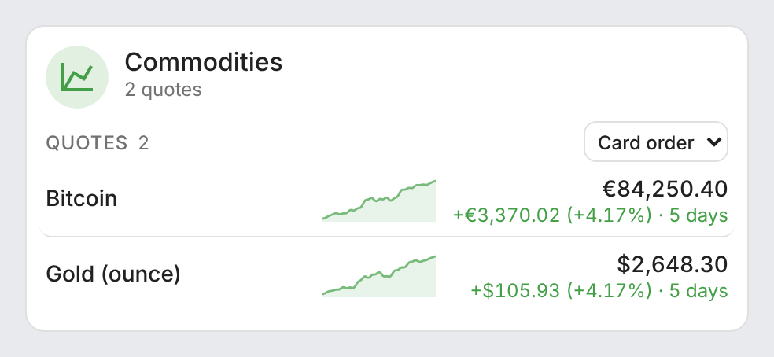 | 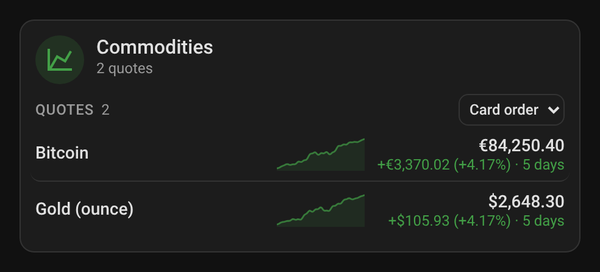 |

## Screenshots

| Light | Dark |
|---|---|
|  | 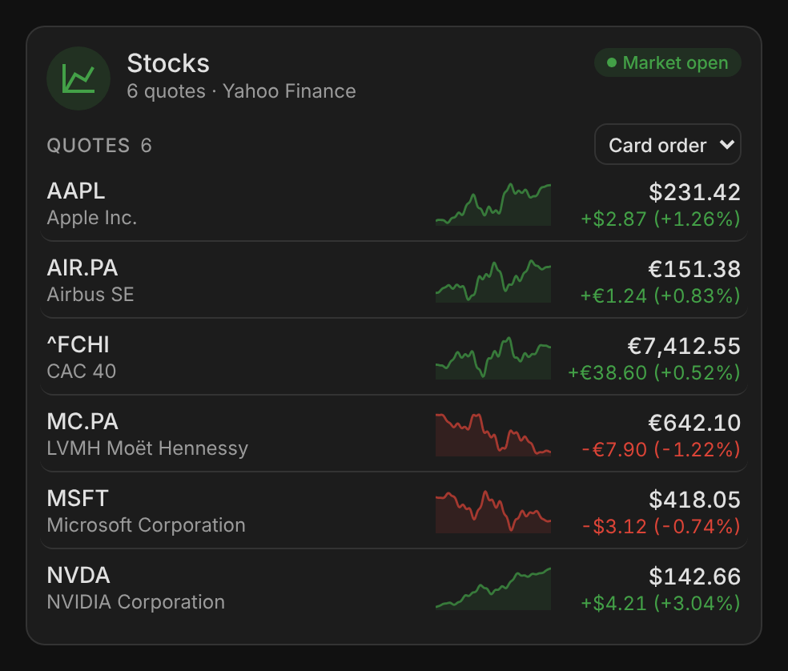 |
|  | 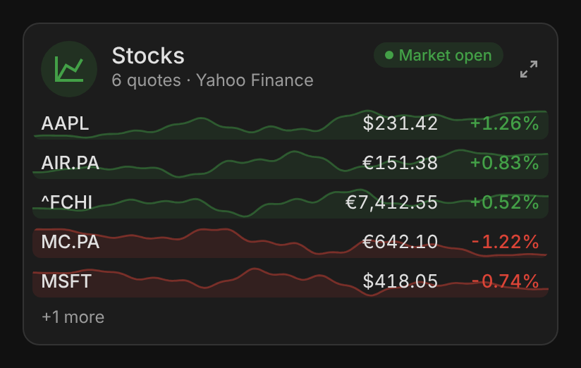 |
| 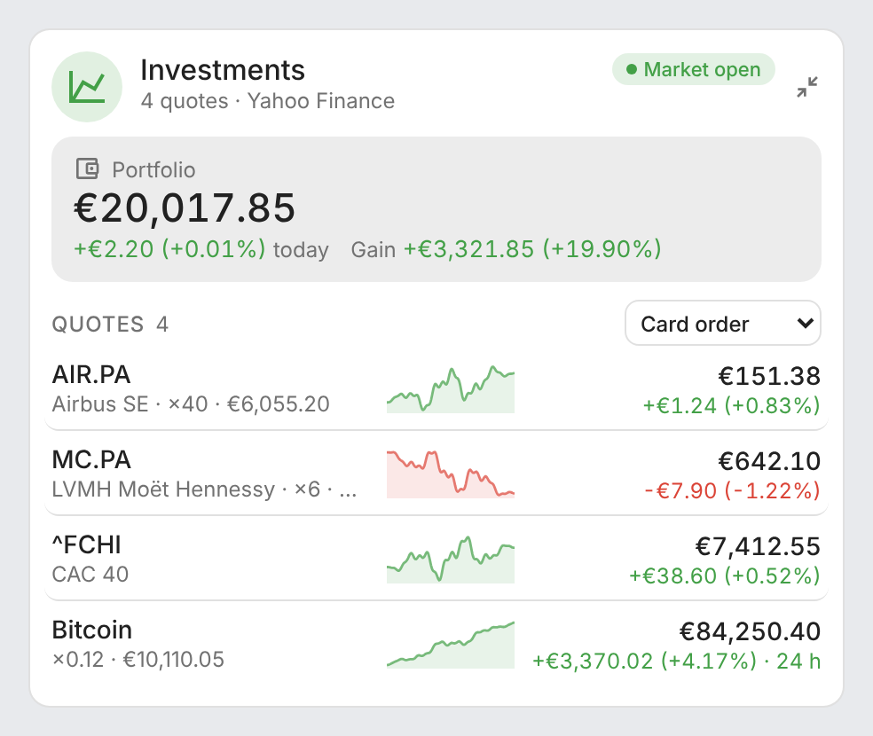 | 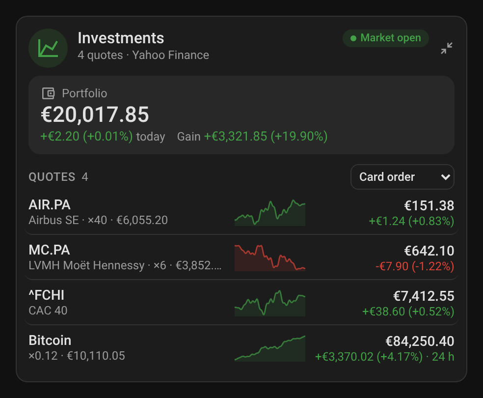 |

### Animations

| Animation | Light | Dark |
|---|---|---|
| Price ticks | 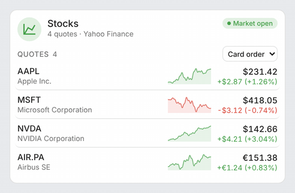 | 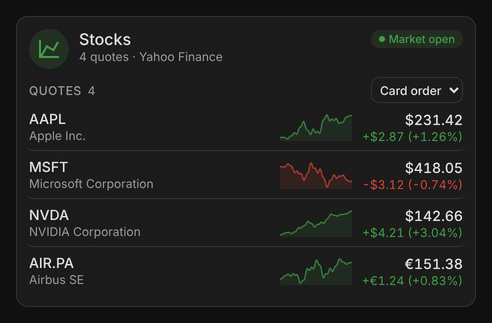 |
| Mini card detail button | 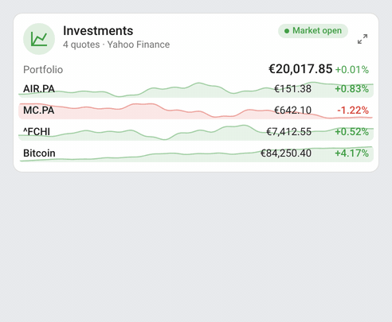 | 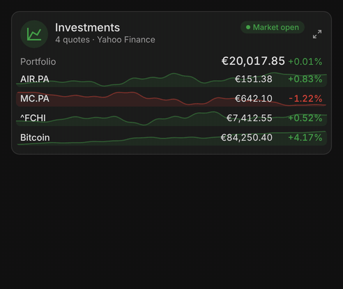 |

- `card-ticks.gif` / `card-ticks-dark.gif` — a new price flashes green when it rises and red when it falls, then fades out.
- `mini-card-zoom.gif` / `mini-card-zoom-dark.gif` — the detail button switches the mini card to the full card and back.

## How it works

Yahoo Finance sensors are found through the entity registry (platform `yahoofinance`), or by their quote attributes (`symbol` and `regularMarketPrice`) when they have no registry entry. The price is the sensor's state; the change of the day, the previous close and the market status come from its attributes.

The sparklines read the recorder's long-term statistics (`recorder/statistics_during_period`, mean of each period), which Yahoo Finance sensors have (`state_class: measurement`). A sensor without statistics falls back to its state history. They are fetched again every 5 minutes, and each curve ends on the live price. A quote with no data in the period has no curve.

Market status, from the most active of the card's Yahoo Finance quotes:

| `marketState` | Chip |
|---|---|
| `REGULAR` | Market open (green) |
| `PRE`, `PREPRE` | Pre-market (orange) |
| `POST`, `POSTPOST` | After hours (orange) |
| `CLOSED` | Market closed (grey) |

The header icon is tinted by the day's move: of the portfolio total when there is one, else of the quotes on average.

## Development

```bash
npm install
npm run build        # bundles src/stock-card.js into dist/stock-card.js
npm run check        # builds and checks the card (run in CI)
npm run screenshots  # renders the cards with mock data (scripts/mock-states.mjs) into screenshots/, PNG and animated GIF (needs ffmpeg)
```

The **Screenshots** workflow re-renders `screenshots/` on every pull request touching `src/`, `scripts/`, `images/` or `package-lock.json` (a Playwright/Chromium bump changes the rendering) and commits the refreshed captures onto the pull request's branch, so the README always matches the code.

`dist/` is not committed: `npm run build` creates it locally, CI builds it on every push, and the release workflow attaches the built file to the release, which is where the Marketplace installs it from.

### Releasing

1. Bump `version` in `package.json`
2. Add a `## <version>` section at the top of [CHANGELOG.md](https://github.com/juju35/ha-stock-card/blob/main/CHANGELOG.md)
3. Push to `main`: the **Release** workflow builds the card, creates the tag and the GitHub release with the changelog section as notes, and attaches `stock-card.js`

## Translations

The cards auto-detect the language from your Home Assistant settings. Currently supported:

| Language | Code |
|---|---|
| English | `en` |
| Français | `fr` |
| Deutsch | `de` |
| Español | `es` |
| Српски | `sr` |
| Srpski (latinica) | `sr-Latn` |
| Italiano | `it` |
| Nederlands | `nl` |
| Português (European) | `pt` |
| Polski | `pl` |
| Română | `ro` |
| Dansk | `da` |
| Svenska | `sv` |
| Български | `bg` |
| Русский | `ru` |
| Українська | `uk` |
| Magyar | `hu` |
| Slovenčina | `sk` |
| Čeština | `cs` |
| Slovenščina | `sl` |
| Latviešu | `lv` |
| Ελληνικά | `el` |

Contributions for additional languages are welcome!

## Credits

The Yahoo Finance integration is a project by [iprak](https://github.com/iprak/yahoofinance). Quotes are provided by Yahoo Finance; this card is not affiliated with Yahoo.

## License

[MIT](https://github.com/juju35/ha-stock-card/blob/main/LICENSE)

## Support

If you find this project useful, you can support its development:

<a href="https://buymeacoffee.com/julienstep9"></a>
